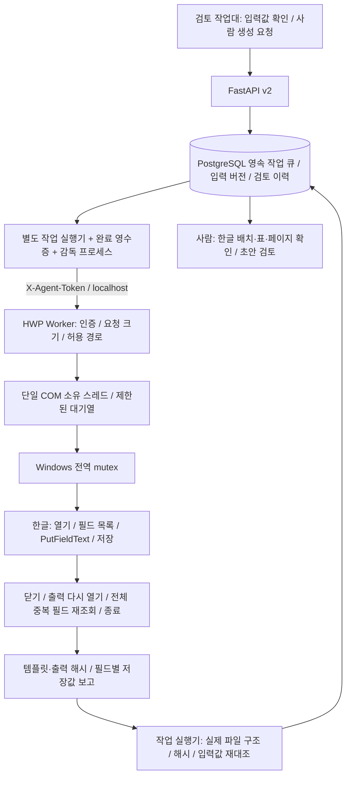

# Windows HWP Worker

2026-09-10 업데이트. 저장소 내 구현. PLECS 실생성은 [16쪽 대조 기록](hwp-layout-implementation-2026-09-10.md)을 참고한다. 운영 전환이나 내용 승인을 뜻하지 않는다.

## 서비스 구조



영속 큐는 PostgreSQL 작업 실행기에 있다. HWP Worker 내부 큐는 COM 직렬화용이며, HTTP 시간 초과가 실행 취소를 뜻하지 않는다.
실행 중인 요청은 재호출하지 않는다. 출력이 존재하면 덮어쓰지 않고, 작업대의 확인 후 복구 기능으로 새 작업번호/파일을 사용한다.

## 설정과 실행

로컬 Windows API와 작업 실행기를 사용한다. Docker 공유 경로/외부 공개는 이 버전에서 지원하지 않는다.

```powershell
pip install -e ".[hwp-worker]"
python -m api.hwp_worker --check
python -m api.hwp_worker --port 8000
# 로그인한 Windows 사용자 세션의 표준 시작 (중복 포트/설치/토큰/허용 경로 검사)
./infra/start-hwp-worker.ps1 -Python python -Port 8000
# 새 proposal_layout_v1 템플릿 최초 등록: 올바른 검증 DB를 지정한 환경에서만 실행
python -m api.hwp_fields prepare-template
```

API를 직접 실행할 때도 `uvicorn api.main:app --env-file .env --host 127.0.0.1 --port 8002`로 같은 설정을 읽는다.
`infra/start-workspace.ps1` 및 작업 실행기/감독 프로세스의 CLI도 `.env`를 읽되, 명시적으로 전달한 검증 DB·포트 환경을 우선한다.

루트 `.env`는 기존 설정을 덮어쓰지 않고 읽는다. 비밀값을 대화·로그·명령행 인수에 넣지 않는다.
`python -m api.hwp_fields seed`는 빠진 회사·템플릿·매핑만 추가한다. 관리자가 바꾼 경로·필드와 비활성 상태는 초기화하지 않는다.
기존 회사정보를 갱신할 때만 `python -m api.hwp_fields seed --update-company-from-env`를 명시한다. 비어 있는 설정값으로 기존 값을 지우지 않으며 회사 메타데이터와 활성 여부도 보존한다.

| 설정 | 의미 |
|---|---|
| `HWP_AGENT_TOKEN` | API/작업 실행기/Worker 동일한 32자 이상 무작위 비밀값. 빈값 기동 거부 |
| `HWP_AGENT_BASE_URL` | `http://127.0.0.1:8000` |
| `HWP_TEMPLATE_ROOT` | 템플릿 허용 루트. 현재 seed 기준 `data`, 파일은 `data/templates` |
| `HWP_SOURCE_ROOT` | 본문 추출 허용 루트. `data/workspace/uploads` |
| `HWP_OUTPUT_ROOT` | 생성물 허용 루트. `data/workspace/exports` |
| `WORKSPACE_DATA_DIR` | API/작업 실행기의 작업 파일 위치. 기본 `data/workspace` |

모든 루트 폴더가 먼저 존재해야 한다. 절대 경로를 권장한다. 출력 루트 자체는 입력 루트와 같을 수 없다.
경로 탈출, UNC, 심볼릭 링크/Windows junction, 기존 출력 파일, 50MB 초과 원본을 거부한다.
Worker는 전용 경로만 사용하고, 임의 디렉터리를 생성하지 않는다. 원문이 다른 폴더에 있으면 작업대에 등록해 관리 경로로 가져온다.

## 인터페이스

모든 경로는 `X-Agent-Token` 인증이 먼저다. API 문서 화면은 비활성이다.

| 요청 | 반환/의미 |
|---|---|
| `GET /health` | 설치/등록 상태, 내부 큐 상태, `state`, `accepting`, `operation`의 작업번호·단계·호출명·경과 시간. `generation_verified:false`는 실제 문서 검증과 별개라는 뜻 |
| `POST /document/fields` `{path}` | 템플릿 필드명, 중복 필드 번호, 현재 값 |
| `POST /document/analyze-file` `{path}` | 허용 원문에서 한글 본문 추출, 해시/필드 정보 |
| `POST /document/put-fields` `{template_path,output_path,values,visible,operation_id?,render_pages?}` | 필드별 생성 결과 및 버전 1 저장값 검증 보고. 페이지 요청 시 저장 후 한글 페이지 PNG/해시 반환 |
| `POST /document/generate` | `put-fields`와 동일한 요청·응답 및 인증·직렬화·복구 계약. 내부 UseCase 오케스트레이션 진입점 |
| `POST /document/create-template` `{operation_id,base_template_path?,output_path,layout,visible?}` | 검증된 서식 명세로 새 작업용 HWP 제작. 저장·재열기·필드 확인, 기존 파일 덮어쓰기 거부 |

값은 문자열 사전이며 최대 2,000개 필드다. 필드 인덱스 직접 지정과 프로토콜 구분자 삽입은 거부한다.
반환 본문은 20만 자, 필드 하나의 저장값은 10만 자, 필드 전체 저장값은 100만 자를 넘으면 실패로 처리한다.
이 제한은 COM 반환 후 적용되므로 한글 자체의 압축 해제/메모리 사용량까지 제한하는 장치는 아니다.
기존 외부 Agent의 RAG/임의 합성 API를 구현한 대체품은 아니다. v2 매핑 기반 생성, 제한된 Markdown 서식의 실제 표 생성, 본문 추출을 지원한다. 원격 자산 로딩·HTML 실행은 허용하지 않는다.

보고는 `template_sha256`, `output_sha256`, `template_fields`, `saved_fields`, `readback`, `lifecycle`을 포함한다.
같은 이름의 필드는 전체 입력한 뒤 `필드명{{0}}`, `필드명{{1}}`처럼 각각 읽는다. 줄바꿈 CRLF/CR만 LF로 통일하며 실제 값은 정밀 비교한다.
구조 검증과 모든 저장값 대조가 통과해야 해당 검증 상태가 확인됨이다. 누락·미매핑·잔여 필드 경고와 최종 사람 검토는 그대로 유지한다.

## 실패와 복구

- `hwp_com_registration_missing`: 한글 편집기 설치/초기 실행/공식 복구 절차를 담당자가 확인한다. 레지스트리를 임의 수정하지 않는다.
- `worker_busy`: 다른 COM 작업이 실행 중이다. 기존 작업 완료 후 상태를 확인한다.
- `operation_uncertain`: HTTP 응답 시간 초과지만 COM 작업이 계속될 수 있다. 자동 재시도 금지, 기존 한글 창/출력 확인 후 작업대 복구 사용.
- `mutex_abandoned`, `com_state_uncertain`: 앞선 작업이나 종료가 불확실하다. 담당자 확인 후 Worker를 재시작한다.
- `recovery_required`: 출력 루트의 `.hwp-active.json`이 남아 있다. 단순 재시작으로 차단을 해제하지 않는다.
- `document_save_failed`, `saved_value_mismatch`: 파일을 정상 승인하지 않는다. 템플릿 필드/저장 형식/경로를 확인한다.

보안 허용/인증 창은 사람이 처리한다. Worker는 보안 DLL 설치·등록, 메시지 박스 우회, 사용자 한글 프로세스 일괄 종료를 하지 않는다.

COM 호출 직전에 디스크에 실행 표식을 만들고, 호출 및 종료가 정상 확인된 경우에만 지운다.
각 호출 직전 `.hwp-progress.jsonl`에 작업번호·단계·시각·호출명만 기록하며 본문과 토큰은 넣지 않는다. 실행 중 시간 초과는 큐를 닫고 미시작 요청을 취소한다. 늦은 성공이나 Worker 재시작은 복구 차단을 해제하지 않는다.
예외·강제 종료·정리 실패가 있으면 표식이 유지된다. 담당자는 해당 Worker를 중지하고 기존 한글 창과 출력 파일을 확인한 뒤 아래 절차를 수행한다.
한 PC에서 하나의 HWP Worker와 고정 출력 루트를 사용한다.

```powershell
python -m api.hwp_worker --recovery-status
python -m api.hwp_worker --confirm-recovery --expected-marker-sha256 <확인한-표식-해시> --note "기존 한글 창과 파일 확인 결과"
```

이 승인은 작업 재실행/문서 승인이 아니라 COM 상태 확인 기록이다. 표식의 원본 프로세스가 살아 있거나 PID 확인이 불가능하면 거부한다.
이전 표식과 의견은 `.hwp-recovery`에 보존한다. 새 Worker 실행 후 작업대에서 새 생성 작업으로 복구한다.
표식이 손상된 경우 무시하거나 임의 삭제하지 않고 운영자가 원본을 보존한 뒤 별도 점검한다.

## 실제 확인 절차

1. 담당자가 한글을 실행해 편집 가능/인증 완료 상태를 확인한다.
2. 입찰참가신청서·제안서 두 템플릿에 DB 매핑 필드명을 삽입한다. 제안서 전체 본문 매핑도 확인한다.
3. 로컬 설정으로 토큰/허용 경로를 맞추고 Worker를 실행한다. 설치 확인과 실제 파일 열기를 따로 확인한다.
4. `HWP_LIVE_SMOKE=true`, `HWP_LIVE_TEMPLATE` 절대 경로, `HWP_LIVE_VALUES_PATH` 로컬 JSON 경로, `HWP_OUTPUT_ROOT`를 지정하고 `pytest tests/test_hwp_worker_live.py`를 명시 실행한다.
5. 이 시험은 새 파일과 `.verification.json`을 남긴다. 결과 파일을 직접 열어 한글·표·페이지·필드 배치를 검토하고 기록한다. 자동 시험 통과가 배치 검토 통과는 아니다.
6. 두 템플릿 및 HILS/소프트웨어/물품 공고 3건의 원문과 생성물을 대조한 후에만 운영 전환을 검토한다.

## 2026-09-07 실기 이력

한글 실행 파일 `C:/Program Files (x86)/Hnc/Office 2022/HOffice120/Bin/Hwp.exe` (12.0.0.535)와 pywin32가 확인됐다.
2026-09-07 사용자 승인으로 설치된 `Hwp.exe -regserver`를 관리자 권한 실행하여 COM 등록을 복구했다.
진단은 `hwp_com_registered_activation_unverified`로 바뀌었다. 보안 우회나 수동 레지스트리 편집은 하지 않았다.

후속 실연동에서 로컬 `.env`에 무작위 인증 토큰과 허용 경로를 설정하고 Worker를 `127.0.0.1:8000`에서 실행했다.
검증 API(8002)와 유휴 작업 실행기만 재시작했으며 다른 실행 환경은 유지했다. 토큰은 문서·로그에 기록하지 않는다.

| 실제 확인 | 결과 |
|---|---|
| Worker 인증 health | HTTP 200, `ok:true`, 큐 유휴, 복구 필요 없음 |
| 인증 없는 health | HTTP 401 |
| 검증 API `/documents/hwp-agent/health` | HTTP 200, `ok:true` |
| 전자파 해석 SW 공고 `R26BK01674250-000`의 저장된 HWP 읽기 | HTTP 200, 본문 7,546자, 원본 SHA-256 불변 |
| COM 수명주기 | `opened`, `readback`, `closed`, `quit` 확인 |
| 해당 공고 원본의 필드 | 0개. 자동작성 템플릿으로 간주하지 않음 |
| 실제 필드 입력·생성·배치 검토 | 미실행. 아래 양식 파일이 없음 |

필요한 양식 경로는 `data/templates/입찰참가신청서_양식.hwp`, `data/templates/제안서_양식.hwp`다.
각 양식은 `/documents/hwp-templates`의 활성 `hwp_field_name`과 같은 필드명을 갖춰야 한다.
원본 읽기 시험은 작업대의 입력 버전·요구사항·사람 확인 상태를 변경하지 않았다.
`generation_verified:false`는 유지하며, 실제 생성과 사람의 배치 검토 전에는 완료로 표시하지 않는다.

자동 검증 기록: 전체 백엔드 983 passed / 9 skipped(기본 데이터 보존 후속 포함), 프론트 126 passed, 분리 환경 브라우저 E2E 2 passed.
실제 HWP opt-in은 미실행이며, 모의 COM/필드 검증 결과를 실제 한글 생성 결과로 표시하지 않는다.

데스크톱 API 근거: [한컴 공식 HwpAutomation 문서](https://github.com/hancom-io/devcenter-archive/blob/main/hwp-automation/HwpAutomation_2504.pdf).
웹한글 API와 혼용하지 않는다. 실제 제품 버전별 SaveAs 지원·중복 필드·프로세스 독립성은 실기 검증 대상이다.
