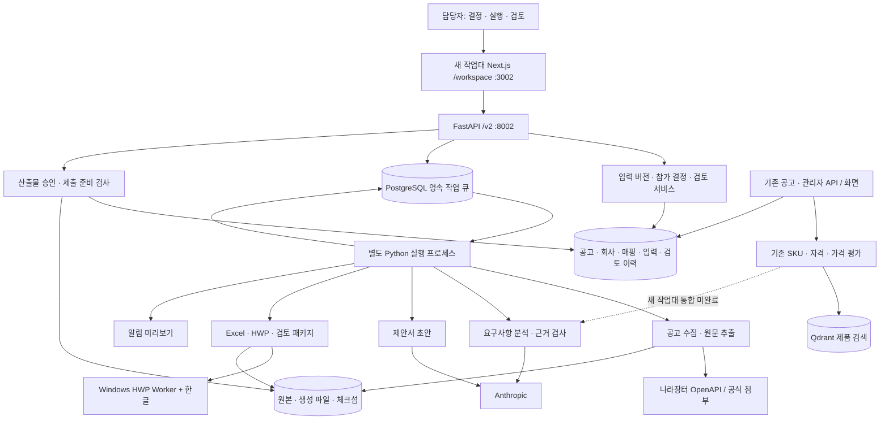

# autoJEBI 서비스 구조 및 보완 검토

검토일: 2026-09-07. 대상은 현재 로컬 코드이며, 운영 배포 완료 여부를 뜻하지 않는다.

## 1. 우선 발견 사항

**판정: 운영 전환 보류.** 기존 안전장치는 개선됐지만 잘못된 확인 상태를 유지하는 경로가 남아 있다. 이번 검토에서는 제품 코드를 변경하지 않았다.

| 우선순위 | 문제와 재현 조건 | 영향 | 수정 및 통과 기준 |
|---|---|---|---|
| P1 | `raw`를 그대로 두고 정규 컬럼 `base_price`를 변경해도 입력 서명이 동일하다. `open_date`, `source`도 서명에서 빠져 있다. | 작업대가 이전 사실을 계속 사용하고 기존 승인 무효화가 시작되지 않는다. | 원문에서 스냅샷으로 사용하는 모든 사실을 동일한 정규화 함수로 해시한다. 각 컬럼 변경 시 동기화 요구·기존 준비완료 해제를 검증한다. |
| P1 | 본문 추출 결과를 반영하면 원문/근거 텍스트는 바뀌지만 연결 요구사항의 `accepted`가 남는다. | 이전 인용이 새 본문에 없고 증빙이 미확인인데도 요구사항은 확인된 것으로 집계된다. | 수동 본문 수정과 추출 결과 반영을 공통 변경 서비스로 통합한다. 연결 요구사항·섹션을 재검토로 전환하고 최종 준비 검사에서도 근거 유효성을 다시 확인한다. |
| P1 | 필수 요구사항 A/B가 모두 확인된 상태에서 제안서 섹션이 A만 다뤄도 차단 목록은 비어 있다. | 제안서에서 필수 항목이 빠진 것을 준비 검사로 발견하지 못한다. | 필수 요구사항과 제안서 섹션의 대응을 검사한다. 제안서 반영 대상/증빙으로만 충족할 항목을 구분하고 예외는 사람의 사유를 기록한다. |
| P1 | Worker가 비어 있지 않은 잘못된 파일과 빈 `replaced/missing/remaining_placeholders`를 반환해도 정상 결과가 가능하다. | 해시는 잘못된 파일의 동일성만 보장한다. 실제 한글 형식/입력 성공을 검증하지 않아 실패 파일이 승인 대상이 된다. | 응답 성공 여부와 필드별 결과를 엄격 검증하고 예상 필드 집합과 대조한다. 실제 형식 확인과 한글 재열기 검증을 추가한다. |
| P2 | 같은 입력 버전으로 첫 창에서 승인 후, 오래된 두 번째 창의 반려 요청도 200으로 받아들인다. | 이력은 보존되지만 최신 검토 판단이 충돌 경고 없이 바뀐다. | 입력 버전과 별도로 검토 버전 또는 `expected_review_id`를 요구한다. 오래된 검토 변경은 409로 거부한다. |
| P2 | 실행은 끝났지만 완료 상태를 DB에 기록할 때 일시 연결 오류가 발생하면 예외가 Worker 밖으로 전파된다. | 실행 프로세스가 종료되고 작업은 running, 후속 작업은 queued로 남는다. DB 복구만으로는 다시 처리되지 않는다. | 생존 감시/재시작과 완료 기록 재시도를 분리한다. HWP 실행 자체는 재호출하지 않고 불확실 결과 확인 절차를 둔다. |
| P2 | 생성 파일이 사라져도 같은 입력 버전/템플릿의 새 요청은 기존 succeeded 작업을 반환한다. | 다운로드와 승인에 실패해도 파일을 복구하기 위한 재생성이 막힌다. | 재사용 전에 파일 무결성을 확인한다. 명시적인 복구 요청과 새 시도를 제공하되 HWP 불확실 실행은 사람 확인을 요구한다. |
| P2 | 동일 참가 결정을 다시 저장하면 내용이 그대로여도 버전이 올라가고 LLM 2회 한도가 새로 생긴다. | 원문이 바뀌지 않았는데 유료 분석을 반복할 수 있다. 같은 원문 결과 재사용과 비용 제한 취지가 약해진다. | 업무 결정 버전과 분석 입력 지문을 분리하고 무변경 저장은 버전을 올리지 않는다. 버전당/공고당 비용 정책도 문서와 일치시킨다. |

근거:
- 입력 변경 감지: [service.py:69](../api/workspace/service.py#L69), 실제 스냅샷 필드 [service.py:189](../api/workspace/service.py#L189).
- 추출 반영: [workspace.py:159](../api/routers/workspace.py#L159), 비교할 수동 수정 처리 [workspace.py:256](../api/routers/workspace.py#L256).
- 최종 차단 검사: [service.py:250](../api/workspace/service.py#L250), 섹션 검사 [service.py:272](../api/workspace/service.py#L272).
- 검토 변경: [service.py:403](../api/workspace/service.py#L403), 이력 추가만 하는 부분 [service.py:440](../api/workspace/service.py#L440).
- HWP 결과 검사: [execution.py:401](../api/workspace/execution.py#L401), 일반 파일 검사 [execution.py:42](../api/workspace/execution.py#L42), 응답 기본값 처리 [hwp_agent_client.py:241](../api/services/hwp_agent_client.py#L241).
- Worker 종료 경로: [worker.py:102](../api/workspace/worker.py#L102), 메인 반복 [worker.py:137](../api/workspace/worker.py#L137).
- 성공 작업 재사용: [service.py:376](../api/workspace/service.py#L376).
- LLM 한도: [execution.py:65](../api/workspace/execution.py#L65), 결정 저장 [workspace.py:106](../api/routers/workspace.py#L106).

## 2. 실행 구조

아래 서비스는 업무 책임 단위다. 별도 마이크로서비스 10개를 운영하는 구조가 아니다. Next.js 화면, FastAPI API, Python 작업 프로세스, PostgreSQL, Qdrant, 별도 Windows HWP Worker로 구성된다.
후속 보완으로 Worker 코드는 `api/hwp_worker`에 추가됐다. 위 발견 사항은 최초 검토 기록이며, 현재 해결/검증 상태는 [보완 실행 기록](remediation-progress-2026-09-07.md), Worker 내부 서비스 도식은 [HWP Worker](hwp-worker.md)를 참조한다.

새 큐에서는 분석·추출·생성·알림 미리보기까지 같은 실행 잠금을 사용한다. HWP만 잠그는 구조가 아니므로 긴 한글 작업 동안 다른 작업도 대기한다. 단일 담당자 v1에는 보수적 선택이지만, 실제 HWP 프로세스 전체에 대한 잠금 보장은 별도 확인이 필요하다. 기존 동기 API는 이 큐를 모두 거치지 않는다.

## 3. 서비스별 보완 내역

| 서비스 | 담당 코드 | 적용된 보완 | 남은 보완/검증 |
|---|---|---|---|
| 작업대·명령 접수 | `frontend/src/app/workspace`, `api/routers/workspace.py` | 사람 실행, 참가 결정 분리, 입력 버전 검사, 실행 기록 표시 | 검토 상태를 의견 문구와 별도로 명시, 기관/마감 중심 목록, 새 설정 화면 연결 |
| 공고 수집·정규화 | `api/collector`, `api/services/notice_facts.py` | API/수동 등록 정규화 공유, 예산을 기초금액으로 대체하지 않음 | 사실 출처 변경 감지 P1, 실제 G2B 검색·첨부 성공 회귀 |
| 원문·증빙 | `api/workspace/execution.py`, `api/services/uploads.py` | 파일 역할·해시, 원문 자동 증빙 인정 차단, 수동 본문 보완 | 추출 반영 시 요구사항 재검토 P1, 실제 HWP/HWPX와 스캔 PDF 검증 |
| 영속 작업 실행 | `api/workspace/worker.py` | 작업번호 즉시 반환, 중복방지, 실행 인수 잠금, 만료 작업 실패 기록 | 작업 프로세스 감시/자동 재시작, DB 단절·장기 실행·불확실 HWP 복구 실증 |
| 요구사항·근거 | `api/workspace/execution.py`, `api/routers/workspace.py` | 원문 인용 존재 검사, 수동 대응/근거 확인, 오류 시 점수 미생성 | 범주별 확인 방식, 변경 후 인용 재검증, 실제 공고 정답표 대조 |
| SKU·자격·가격 평가 | `api/grading`, `api/sku`, `api/ontology` | 기존 평가 기능 유지, v2는 확인율과 미평가 null을 구분 | 기존 3축 평가·Qdrant를 새 입력 스냅샷에 통합. v2 확인율은 적합도 점수가 아님 |
| 제안서 | `api/workspace/proposal.py` | 근거 ID·수치 검사, 검증필요 표시, 섹션 사람 승인, 버전별 LLM 2회 한도 | 필수 요구사항 커버리지 P1, 근거 연결 수정 UX, 실제 LLM 결과 품질 검증 |
| Excel/HWP 생성 | `api/workspace/execution.py`, `api/services/hwp_agent_client.py` | 필드 미리보기, 필수값 차단, 허용 경로·토큰, 해시·잔여 필드 기록 | 실제 필드 목록 대조, Worker 응답 엄격 검증, 한글 열기/레이아웃 확인 |
| 검토·패키지 | `api/workspace/service.py`, `run_package` | 실패 파일 승인 차단, 입력 버전별 검토, 원본/산출물/누락/이력 패키지 | 오래된 검토 변경 방지 P2, 최종 근거·범위 재검증, 무경고 실제 패키지 |
| 알림·설정·운영 | `api/services/notifications.py`, `/v2/settings`, `infra/start-workspace.ps1` | v2 알림 미리보기만 제공, 등록 여부와 실행 이력 구분, 검증 포트 분리 | 연결 상태 전용 검사, 백업/복원 실증, 기본 화면 전환 승인 |

### 책임 경계 평가

- **개선됨:** 실행 상태와 사람의 참가 결정이 분리됐고, 예전 오류를 성공 점수로 저장하는 경로가 보정됐다.
- **부분 분리:** 큐 실행기는 분리됐지만 `execution.py`가 수집·추출·분석·HWP·Excel·패키지를 함께 담당한다. `service.py`도 원본 동기화·버전·집계·승인을 함께 담당한다.
- **결합 남음:** 새 모듈이 DB 테이블을 `api.routers.notices`에서 가져오고, v2 라우터가 기존 라우터 함수를 직접 호출한다. 다음 단계에서는 DB 정의와 공통 업무 서비스를 라우터 밖으로 이동하되, 안전 결함 수정과 한 번에 섞지 않는다.
- **전환 중:** 기존 `bid_pipeline.status`와 동기 API는 계속 존재한다. 새 규칙이 모든 화면에 동일하게 적용됐다고 해석하면 안 된다.

## 4. 이번 검증과 이전 기록 구분

### 2026-09-07 직접 실행

- 기존 `tests/test_workspace_v2.py`: **17 passed**.
- 별도 리뷰 재현 검사: **4 passed**. 이는 올바른 동작 4건이 아니라 **금액 변경 감지·추출 후 확인 상태·제안서 범위·검토 충돌 결함 4건이 재현됐다는 뜻**이다.
- 추가 독립 코드 검토에서 HWP 잘못된 파일의 정상 처리, 완료 DB 기록 실패 시 Worker 종료, 유실 파일 재생성 차단, 무변경 결정 저장 후 LLM 예산 갱신을 모의 환경으로 재현했다. 이 추가 4건은 위 재현 파일의 4건이나 정식 테스트 통과 수에 포함하지 않는다.
- 재현 검사는 in-memory SQLite와 API/서비스 함수를 사용했다. 추출 결과는 모의 결과를 사용했으며 실제 LLM/HWP/G2B 호출은 하지 않았다.
- 재현 파일: `data/workspace/review-2026-09-07/test_review_probes.py`. 런타임 검토 자료로 Git 제외. 수정 후에는 기대값을 안전한 동작으로 바꿔 정식 회귀 테스트에 편입한다.
- 운영 DB·회사 증빙·참가 결정·실제 승인 상태는 변경하지 않았다.

### 이전 구현 기록, 이번에 전체 재실행하지 않음

2026-09-06 문서 기록: 전체 백엔드 456 passed / 1 skipped, PostgreSQL 전용 동시성 1 passed, 프론트 120 passed, v2 E2E 1 passed, 타입·린트 통과. 이 결과는 위 안전 결함이 없다는 보증이나 실제 HWP 성공 증거가 아니다.

## 5. 보완 순서와 완료 기준

1. **판단 안전성:** 사실 해시 누락, 추출 의존성 무효화, 제안서 범위 검사를 먼저 수정한다. 하나의 변경 서비스와 하나의 최종 준비 검사로 목록·상세·생성·승인을 일치시킨다.
2. **검토 충돌·복구:** 검토 버전, Worker 생존 감시, 불확실 HWP 작업의 확인 후 재개를 보완한다. 늦은 응답·DB 단절·프로세스 종료를 재현한다.
3. **실무 연결:** SKU/자격/가격 평가, 실제 LLM, HWP 템플릿 2종을 연결한다. mock 테스트와 실제 파일 확인을 별도 판정한다.
4. **출시 게이트:** HILS·소프트웨어·물품 공고 각 1건의 원문/요구사항/증빙/Excel/HWP/검토 패키지를 담당자가 대조하고 백업 복원까지 확인한 뒤 기본 화면을 전환한다.

실제 G2B 투찰·금액 입력·자동 제출은 계속 범위 밖이다.
